<div align="center">

</div>

<div align="center">

<a href="https://git.io/typing-svg"></a>

</div>

<div align="center">

[](https://dinesh-projects.netlify.app/)
[](https://www.linkedin.com/in/dinesh-s-434359202)
[](mailto:dineshs65663@gmail.com)
[](mailto:dineshs65663@gmail.com)


</div>

<br/>

<!-- ░░░ HERO: ASCII PORTRAIT + TERMINAL ░░░ -->
<table border="0" cellspacing="0" cellpadding="0" width="100%">
<tr>
<td width="42%" valign="middle" align="center">



</td>
<td width="58%" valign="middle">

```console
dinesh@dev:~$ whoami
```


```console
dinesh@dev:~$ cat profile.json
{
  "role"     : "Full-Stack Developer & Bot Engineer",
  "location" : "Bengaluru, India  (UTC +5:30)",
  "stack"    : ["Python", "Django", "React", "MySQL"],
  "learning" : ["Data Science", "DRF", "Docker", "Cloud"],
  "focus"    : "Automation that bots aren't supposed to do",
  "status"   : "🟢 Available for opportunities"
}
dinesh@dev:~$ ▮
```

</td>
</tr>
</table>

---

<div align="center">

### 🧭 About

</div>

Full-Stack Developer and automation builder who ships **web apps, Telegram bots, and OSINT tooling**. I work comfortably across the stack — Python and Django on the back end, React on the front — and I've sharpened my client-facing instincts through real support and engineering roles. I like problems where the answer is "let me build something that handles that for you."

- 💼 &nbsp;**Experience** — Maven Silicon · Prinston Smart Engineers · 24/7 InTouch CX · PTW / Side.inc
- 🎓 &nbsp;**Education** — B.E. Computer Science, KS School of Engineering & Management
- 🌱 &nbsp;**Currently leveling up** — Data Science, Django REST Framework, Flask, Docker
- 🎯 &nbsp;**Looking for** — Full-stack / backend / automation roles where I can own things end to end

---

### 🛠 Stack

<table>
  <tr>
    <td valign="top" width="33%">
      <b>Languages</b><br/><br/>
      <br/>
      
    </td>
    <td valign="top" width="33%">
      <b>Frontend & Backend</b><br/><br/>
      <br/>
      
    </td>
    <td valign="top" width="33%">
      <b>DB & Tools</b><br/><br/>
      <br/>
      <br/>
      
    </td>
  </tr>
</table>

---

<div align="center">

### 🚀 Featured Projects

</div>

<table>
<tr>
<td width="50%" valign="top">

#### 🛋 Furniture E-Commerce
Full-stack store with a dynamic cart, auto-generated invoices, and MySQL-backed order management.

`Django` `MySQL` `JavaScript`

</td>
<td width="50%" valign="top">

#### 🤖 Telegram OSINT Bots
Phone & vehicle lookup bots with an automated data-retrieval pipeline over public APIs.

`Python` `Bot API` `OSINT`

</td>
</tr>
<tr>
<td width="50%" valign="top">

#### 🎮 Game Economy Bot
Telegram game with a full economy, leaderboards, and persistent SQLite state.

`Python` `SQLite` `Bot API`

</td>
<td width="50%" valign="top">

#### 🔐 XOR + Zlib Encoder Bot
Encodes/decodes `.py` files with a custom XOR key layered over zlib compression.

`Python` `Cryptography` `Bot API`

</td>
</tr>
</table>

<div align="center">
<a href="https://dinesh-projects.netlify.app/"></a>
</div>

---

<div align="center">

### 📜 Certifications

</div>

| Certification | Issuer |
|---|---|
| 🔵 IBM Data Science Professional Certificate | Coursera |
| 🟢 Python Certification | HackerRank |
| 🟣 Python Full Stack & Data Science | PySpiders |
| 🟠 Data Analytics & Visualization Simulation | Accenture (Forage) |

---

<div align="center">

### 📊 GitHub Analytics


<br/><br/>


</div>

---

<div align="center">

### 🐍 Watch the snake eat my contributions


</div>

---

<div align="center">

### 💬 Let's build something

<a href="https://www.linkedin.com/in/dinesh-s-434359202"></a>
<a href="https://github.com/Dineshs65663"></a>
<a href="mailto:dineshs65663@gmail.com"></a>
<a href="https://dinesh-projects.netlify.app/"></a>

<br/><br/>

<i>"I build bots that do things people don't expect bots to do."</i>


</div>
